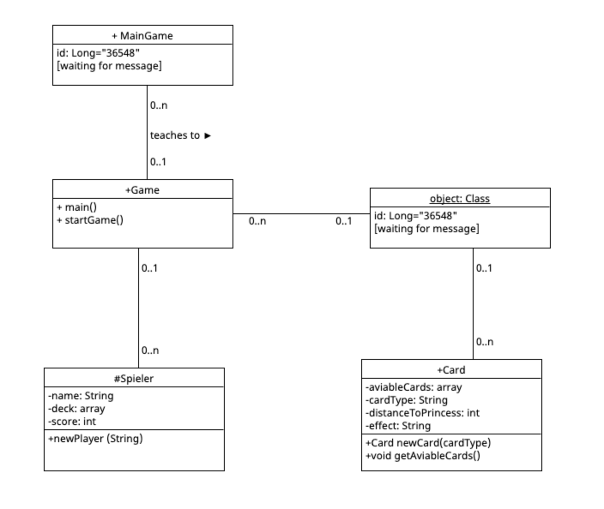

# Love Letter

Das ist meine Dokumentation zur Programmierung vom Spiel Love Letter

## Planung

Das Erste, das in einem Softwareprojekt gemacht werden muss, ist die Planung. Hierfür habe ich mich dafür entschieden ein
UML-Diagramm zu erstellen. Das funktioniert in der Regel natürlich auch ganz gut, allerdings ist bei mir das Problem, dass
ich nicht sehr gut in der Planung im Vorhinein in meinem Projekt bin. Deshalb erstelle ich Anfangs zwar einen Plan, dieser
ist aber nicht sonderlich Aussagekräftig und entwickelt sich dann erst mit der Erstellung meines Projekts zu einem Plan,
mit dem man auch wirklich arbeiten kann. Das UML-Diagramm ,das hier angehängt ist, ist nicht die erste Version, sondern
ein Plan, der eher in der Mitte der ersten Projektphase entstanden ist:

