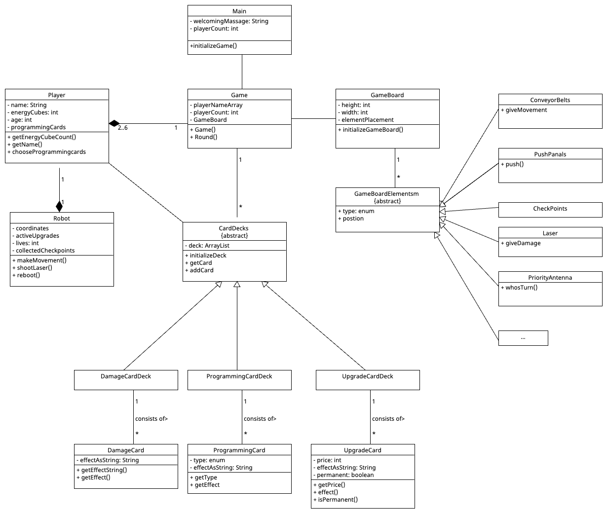

# ROBO RALLY

Das ist meine Dokumentation zur Programmierung vom Robo Rally

## Planung

Das Erste, das in einem Softwareprojekt gemacht werden muss, ist die Planung. Hierfür wird ein UML-Diagramm erstellt.
Ich habe mich dabei für das online Tool von umletino entschieden. Das Problem bei der erstellung von entsprechenden
Diagrammen ist: Viele Klassen werden erst bei Bedarf erstellt und so verändert sich ein entsprechendes Diagramm laufend.
Dennoch ist für die Planung eines Projekts eine strukturschaffende übersicht oder ein Plan essentiell, damit sich
beim programmieren aufs Wesentliche konzentriert werde kann.

## UML-Diagramm

Erklärung:  
Das Spiel braucht wie jedes Projekt in Java eine Main Klasse, die für die Ausführung des Spiels beiträgt. Diese
wird das Spiel dann zum Laufen bringen. In meiner Aktuellen Version des UML-Diagramms wird eine Benutzeroberfläche
noch nicht berücksichtigt. Diese würde zusätzliche Klassen voraussetzten.  
Die Klasse Main erzeugt dann durch Benutzereingaben ein Objekt der Klasse Game.  
Das Game wiederum ist das Herzstück des Projekts und beinhaltet die ganze Logik des Games.
 
Ein Game würde allerdings keinen Sinn ohne Spieler machen, also werden Spieler automatisch miterzeugt und mit diesen
die Roboter Spielfiguren. Man muss in der Praxis noch schauen, ob es eine extra Klasse Roboter braucht, denn eine 
Umsetzung mit Spielern könnte auch ausreichen aber der Modularisierung schaden.
 
Kartendecks spielen in Robo Rally eine große Rolle und deshalb wird Ihnen auch eine eigene Klasse zugeteilt.
Eine genauere beschreibung von Methoden und Variablen ist im Aktuellen noch nicht möglich, da die Struktur des Games noch
nicht feststeht und sich dynamisch im Entwicklungsverlauf laufend ändert. Auch die Beziehungen sind noch nicht Sicher
festzuhalten.
 
Das Spielfeld ist die Komponente im Game auf der sich alles Abspielt. Deshalb muss dieses eine eigene Klasse bekommen.
Im Spiel Roborock gibt es außerdem Viele verschiedene Spielfeldelemente. Um eine gute Übersicht zu geben, wurden einige
Elemente weggelassen.